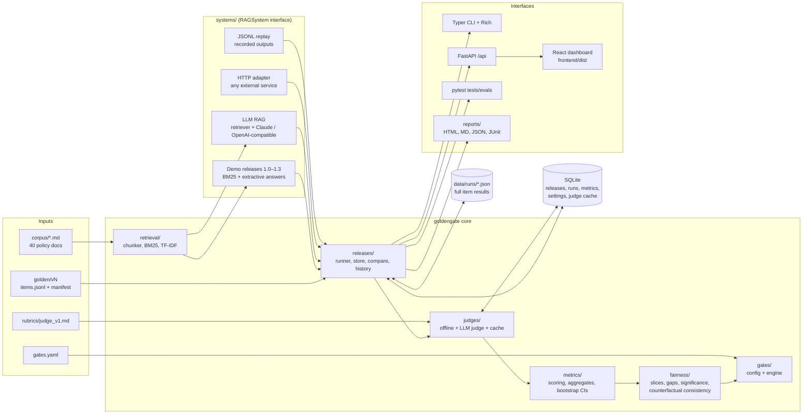
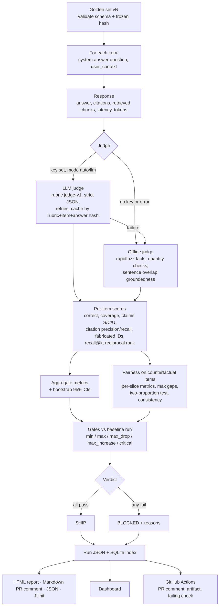
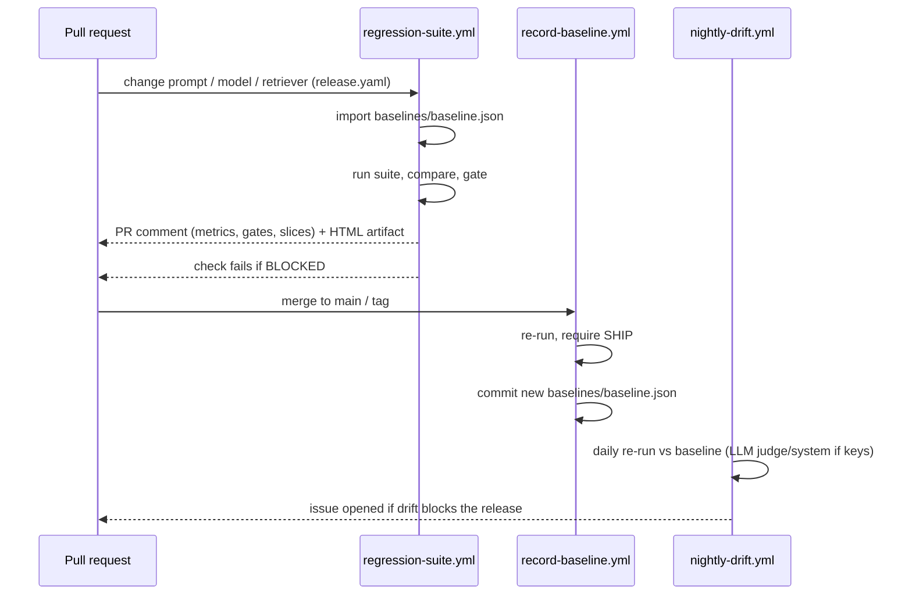

# GoldenGate architecture

GoldenGate evaluates a retrieval-augmented generation (RAG) system against a versioned golden
dataset, scores every answer for accuracy, groundedness, citation quality and fairness, and turns
the results into a SHIP / BLOCKED decision that CI can enforce.

## Components

## Evaluation pipeline

## Release tracking

## Key design decisions

| Decision | Why |
|---|---|
| One run = one JSON file + SQLite index | JSON keeps full item-level evidence portable (CI baseline is a committed run file); SQLite gives fast listing, trends and baseline settings. |
| Section-level chunks with stable slug IDs (`doc#section`) | Citations and gold labels survive re-ordering of documents. |
| Offline judge always available | The whole project runs with no API key; the LLM judge is an upgrade, not a dependency. Every item records which judge scored it. |
| LLM judge falls back per item and disables itself after repeated auth/connection errors | An invalid or missing key never crashes a run or the dashboard. |
| Fairness measured on counterfactual groups only | Variants differ only by a persona cue, so a gap is attributable to the cue and not to question difficulty. |
| Paired bootstrap for deltas | Release comparisons resample the same items in both runs, so CIs reflect the change, not item mix. |
| Gates use point estimates; CIs and p-values are reported next to them | Gates must be deterministic in CI; the intervals show whether a near-threshold change is noise. |
| Frontend built into `frontend/dist` and served by FastAPI | One process on one port; end users do not need Node.js. |

## Module map

| Path | Responsibility |
|---|---|
| `goldengate/core` | Pydantic models, text utilities (sentences, quantities, citations) |
| `goldengate/retrieval` | Markdown chunker, BM25 and TF-IDF retrievers |
| `goldengate/systems` | `RAGSystem` interface, demo releases, LLM RAG, HTTP and replay adapters, registry |
| `goldengate/golden` | Load, validate, diff, freeze and create golden versions |
| `goldengate/judges` | Offline judge, LLM judge, judge factory |
| `goldengate/llm` | Anthropic SDK and OpenAI-compatible JSON clients |
| `goldengate/metrics` | Per-item scoring, metric catalogue, bootstrap, citation and retrieval metrics |
| `goldengate/fairness` | Slice statistics, gaps, significance, counterfactual consistency |
| `goldengate/gates` | `gates.yaml` schema and the gate engine |
| `goldengate/releases` | SQLite models, run store, runner, comparison, history |
| `goldengate/reports` | Markdown / HTML / JSON / JUnit renderers and inline SVG charts |
| `goldengate/cli` | Typer commands |
| `goldengate/server` | FastAPI app, background jobs, launcher |
